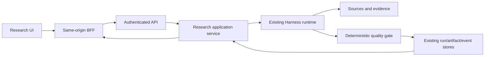

## Context

本变更以个人 Windows 上的 Research 桌面浏览器使用为目标。现有前端工作区、认证、导入、Research application service、Harness runtime 和持久化已经存在，缺口在正式入口、可信身份贯通、报告接线及本机生命周期/恢复交付。

已读取的关键实现：

| 责任 | 当前落点 | 设计含义 |
| --- | --- | --- |
| 浏览器入口 | `frontend/src/app/page.tsx`, `design-demo/*`, `papers/*` | 正式路径迁移必须覆盖历史与两种 reader 入口 |
| 登录与 cookie | `frontend/src/app/login`, `lib/auth`, `proxy.ts` | 不以路由 guard 或共享 API token 代替真实 user owner |
| 前端服务代理 | `frontend/src/lib/api/server.ts`, `app/api/research`, `next.config.mjs` | 同源 proxy 和 `/api/v1` rewrite 都需进入同一授权边界 |
| Workspace | `frontend/src/lib/research/history*.ts`, `interfaces/services/research_history_service.py` | 复用 revision/CAS；客户端状态不是权威持久化 |
| 导入 | `interfaces/services/research_import_service.py`, `research_import_application.py` | 保留现有 import 身份、限额、source policy 与真实解析 |
| Research | `interfaces/services/research_service.py`, `backend/research/application/single_paper_runtime.py` | 复用 analyze/ask、actor scope、run record、quality 与 artifacts |
| 报告 | `frontend/src/features/reports`, `interfaces/services/report_service.py` | 草稿、通用报告、Research 结果有不同 owner，不能混为同一存储 |
| API 启动 | `interfaces/cli/commands/api.py`, `interfaces/api/server.py` | 默认 loopback，复用已有 CLI 并固定工作目录 |
| 运行依赖 | `.venv`, `frontend/package-lock.json`, `docker-compose.yml` | 有 Python 3.12 虚拟环境和 npm lockfile；Docker 并非全栈运行入口 |

项目现有 `research-runtime` 的“UI Out Of Scope”描述的是原后端变更边界。本次独立添加 UI/application 接线，仍保留 Research domain 不依赖 interfaces/infrastructure 的约束。

## Goals / Non-Goals

**Goals:**

- 一条真实、可恢复、owner 明确的本机 Research 用户链路。
- 正式工作区、已有后端能力和本机部署工具共享可验证的配置/版本/数据身份。
- 更新、进程重启、备份和恢复不丢失已经提交的资料，不重复执行不确定结果的请求。
- 实现和测试编写阶段结束后，集中验证一个候选版本，再部署同一构建。

**Non-Goals:**

- 新的 Harness、job scheduler、run store、event store、report truth store 或通用桌面壳。
- 全站改版、移动端重做、公共注册配置、多用户协作、局域网和公网服务。
- 新的跨论文自主综述、扫描件 OCR 引擎或模型选择平台。
- 代替其他 active change 的生产发布资格、触发 P2 连续性或扩大实验 rollout。

## Decisions

### 1. 采用显式本机 profile 与单个同源浏览器入口

引入严格枚举的 `NEWSROOM_DEPLOYMENT_PROFILE=local-desktop`，由启动工具传入前后端，并在配置层验证。端口等启动设置由一份本机配置解析，复用 `NEWSROOM_API_BASE_URL` 和现有 storage/auth/provider 设置；新增键必须在样例中列出语义与优先级。顺序为显式 CLI 覆盖 → 本机运行配置 → 已有根环境/项目配置 → 明确默认值，秘密不进入命令行参数。

默认 frontend `127.0.0.1:3000`、API `127.0.0.1:8000`。本版拒绝非 loopback bind、任意公网 origin 和伪造 Host/Origin；不根据不可信 forwarded header 自动判断本机安全性。非本机 profile 的 HTTP/Secure 要求不变。运行入口不会为了解决错误改成关闭鉴权或开放所有网卡。

备选是复制一套前端/后端配置文件或完整容器化。前者会产生配置分歧，后者目前没有全栈 manifest 且 Windows Docker 尚未可用，因此使用原生进程；只有既定解析路径按需使用 Docker。

### 2. 正式入口与深链接迁移共用业务组件

本机 profile 的 `/` 使用现有研究工作区，抽取中性命名组件，避免两个首页独立演进。论文列表/阅读使用 `/papers`、`/papers/[slug]/read`，分组使用 `/research/groups/[groupId]`，报告使用 `/reports`；实现时核对已有详情、taxonomy 与返回导航，保留非本次改动的子路由。

本变更明确允许保留迁移重定向：`/design-demo` → `/`、`/design-demo/papers` → `/papers`、其 reader/group 深链接 → 对应正式路径。只迁移明确的研究路径，校验 returnTo，不改写任意外部 URL；客户端规范化保留可用定位参数/fragment。没有第二份 reader、历史或工作区状态。

历史/草稿采用可重复执行的规范化和当前 owner 的 CAS 写入。已有非本机 profile 的入口行为不被本机 profile 隐式替换。备选“继续把 demo URL 当作唯一入口”可短期启动，但不足以完成此次正式入口与导航交付。

### 3. 用户会话与服务凭据分开授权

复用现有 auth application service 和 first-user bootstrap。BFF 转发真实 session 到后端受控接口，后端服务通过已验证身份构造 Research actor scope；服务 token 仅用于 BFF/API 之间的服务访问。不能直接接受浏览器的 `tenantId`、`userId`、`memoryNamespace`，也不能由公共 header 任意扮演用户。

对 analyze/ask/run/artifact/export 与 workspace/import 一并建立身份合同；现有共享 public paper cache 保留其明确的公开读取规则，私有产物不能借公开 reader/API 获得。审计 `/api/v1` rewrite 和直接 API 访问，不仅测试 React 页面 guard。

Cookie 由统一 profile helper 生成。只有显式本机 profile、已验证 loopback origin/bind 的 HTTP 会话允许 `Secure=false`，其余仍要求 Secure；HttpOnly、SameSite、到期和服务端撤销始终有效。业务写操作要求有效会话并进行同源校验；bootstrap/login 等既有认证入口允许匿名请求，但仍要求认可 origin、合法输入、频率限制和适用的初始化状态。登录后恢复安全 next path；退出后清理用户缓存，401/过期保留该 owner 可恢复输入且不显示给下一账号。

备选为启用所有 OTP/OAuth，但这会把单机交付耦合到外部供应商；本次沿用本地口令入口。

### 4. 能力查询只做确定性投影

定义小型 capability/readiness 投影，使用 application service 汇总 parser/source/LLM/ask/artifact/config 的真实可用性。结果分别记录 `configured`、`reachable`、`verified`、时间、稳定 reason code 和可执行下一步；不生成与业务实际无关的健康评分。

doctor 默认只检查本机路径、解释器、前端依赖/构建、端口、配置存在性与安全绑定。网络或模型探测必须显式选择，使用已有 source/provider adapter，限制调用数、输入/输出预算和超时；命令退出与页面显示不能将未做 live probe 解释为真实成功。

缺扫描 OCR/dense retrieval 可作为可选能力限制；必交付的真实 PDF、单论文分析与问答路径在最终验收时必须可用。LLM 无权决定 capability admission。

### 5. Workspace 与 notebook 沿用已有 owner

继续使用 history/workspace application service 的 revision/CAS。实施清点每类笔记、选区和阅读状态是否为浏览器本地、账号 workspace 或 reader service 所有；需要长期保留的内容接入其已有 owner 的 application port，不把整套数据复制到 launcher。

API mutation 的成功回执决定“已保存”。客户端 dirty/pending/conflict 与服务端 revision 分开；双标签冲突保留本地编辑，提供显式重读/重试，不能静默覆盖。guest 导入和旧 localStorage 导入必须由用户发起，幂等且不会跨 owner 混入资料。

精确续读包含 source revision 与 section/page 定位，来源变化时显示失效原因和安全落点。重命名、移组、归档、恢复、删除和关联草稿使用已有引用规则，避免悬空引用。

### 6. Source ingestion 复用现有真实解析边界

搜索、arXiv/DOI/GitHub 引用与 PDF 上传从现有 BFF 进入 research/import application service。前端只接受应用投影，不直接调用 parser/container，也不执行项目代码。上传大小/类型、source allowlist、网络限制和 publication 检查沿用原 owner。

导入状态绑定 import/run/source 身份，重复请求有明确合同，失败保留可重试输入。解析不可用时不能退回宿主机绕过 isolation；如果选定解析路径要求 Docker，doctor 说明该要求且 acceptance 保留未完成。对结果不得用空壳正文、缩略摘要或 fixture 假冒完整论文。

### 7. 单论文执行请求可核对，不新增调度器

当前 `analyze` 为有界调用，不能仅为了前端进度直接换成内存 fire-and-forget。先复用当前调用与既有 durable intent/receipt/result 能力；若缺少请求接收或运行查询投影，在相应 application/persistence port 增补，不在 Next.js 或 launcher 创建 job 数据库。

提交合同包含 server-validated owner、paper/source revision、问题/selection、允许的 options 及稳定 request 身份。浏览器在第一次网络发送前生成 request 标识，并把标识、当前已确认实例/恢复代际与请求语义保存在既有 owner-scoped pending/workspace 状态；服务端原子绑定 request fingerprint 与 admission，支持按该标识查询，run/import 身份可随后返回。此合同覆盖分析、问答及有副作用的导入。首次响应完全丢失仍可核对；重复的相同请求查回已有执行/结果，标识复用但内容不同必须拒绝，并发和未知结果恢复不能只靠客户端按钮锁。

前端状态投影可为待提交、等待、运行中、需要操作、通过、拒绝、失败、中断、待核对，但只有服务端真实状态/事件才能驱动迁移。进度事件缺失时显示等待，禁止模拟百分比。刷新/断连先按已提交身份查询；无法确认结果则不自动重新付费执行。停止等待与后端取消区分；取消仅在已有服务合同支持并回执后显示成功。

任何运行仍遵循有界 PLAN → EXECUTE → VERIFY、budget/replan/retry 上限和 durable transition；UI 不决定 gate、routing、memory、tool permission 或 publication。

### 8. Research 报告是既有结果的受控投影

当前通用 report service 与 ResearchAnalysisResult 并不共享同一种存储模型。新增受控 application 投影，将已有 Research `analysis`、`quality`、`artifact_refs`、source revision 和 trace 引用组合成可读报告 DTO；文中没有来源的字段显示缺失，不臆造。

报告列表和保存只维护 owner 范围内的结果引用/草稿关系，正文与质量仍由原 run/artifact store 提供。不能以 UI 状态、LLM 文本或“已经生成”判断通过；诊断和候选与接受结果明确区分。

Markdown/JSON exporter 复用相同授权后的 DTO，携带 run/source/quality/citation 身份。草稿导出明确标注未验证；失败候选不可走 accepted report export。引用回跳校验 paper、revision、locator；损坏 artifact 或已不可用来源有可恢复提示。

本版不添加外部发布渠道，不调用通用 report publish 绕过 Research gate，不自动把多材料草稿变成跨论文模型综述。

### 9. Windows lifecycle 的操作记录不拥有业务状态

建议入口：`scripts/local-desktop.ps1` 作为 Windows 薄包装，使用 `.venv/Scripts/python.exe -m scripts.local_desktop`；复杂配置、进程、备份和验证逻辑放在可测试的 Python 模块中，避免脚本拼接命令。

| 命令 | 合同 |
| --- | --- |
| `doctor [--json] [--probe-network]` | 配置/路径/依赖/能力诊断；live probe 显式且有界 |
| `build` | 生成带 manifest 的 production release，不改秘密配置 |
| `start [--open]` | 单实例、有界 readiness；只启动已准备的 production build |
| `stop` / `restart` | 验证进程归属，停止接收新请求，受控收敛后停止/重启 |
| `status [--json]` | 进程、release、health、能力和诊断，不泄漏秘密 |
| `logs` | 有界读取/跟踪轮换后的脱敏日志 |
| `open` | 打开当前 canonical origin；未运行时给出启动方法 |
| `backup` / `restore` | 受控停写、验证和恢复，见决策 11 |
| `rollback` | 恢复指定已验证版本，见决策 12 |
| `autostart enable/disable` | 可选、明确操作；当前用户登录触发，默认关闭 |

运行记录建议放 `.newsroom/desktop`，只含部署/进程身份、端口、release 指针、健康摘要和日志引用。采用单实例锁和原子更新，记录 PID、创建时间、可执行文件/参数身份、拥有的 child/container。不能根据 PID 或进程名称单独杀进程；端口占用不等于本工具所有。

服务通过安全参数列表启动、固定 cwd、隐藏后台窗口，日志轮换且不记录 `.env`、Authorization/Cookie、provider 密钥或论文/模型全文。失败启动清理本次拥有的资源，不影响已有服务。状态为 STOPPED/STARTING/READY/DEGRADED/STOPPING/FAILED；READY 来自实际健康投影，不能只看端口。

stop/restart 等待既有 bounded operation 收敛。若超时仍有任务，先报告 busy；显式停止只能在既有生命周期允许的范围内处理，不伪造完成或删除记录。自动重启如启用，必须有上限、退避和稳定失败态。

### 10. Production release 绑定源码与依赖

frontend 使用现有 npm lockfile，运行 `npm ci` 的依赖准备属于明确 build/setup 操作；正常 start 不联网安装。后端固定项目虚拟环境并记录解析的依赖版本。验证环境与 release 必须一致，系统 Python 不作为隐式 fallback。

release manifest 包含 revision/source digest、build/config schema、frontend build/lock 摘要、Python/Node 身份、resolved Python dependencies、实际运行模块与资源清单。只打包运行所需源码、前端产物和配置模板；排除 `.env`、真实业务数据和凭据。

使用 `.newsroom/desktop/releases/<release-id>` 或明确配置的 release root，准备完成再原子激活。运行使用受控 release 源码/构建，不依赖可变开发工作树。复用虚拟环境必须核对其依赖 fingerprint；要承诺旧版本可恢复，必须保留或能确定性恢复该版本的依赖与前端运行资源。缺资源/不匹配时拒绝旧版本启动，不宣称 rollback 成功。

备选是直接启动任意 `.next` 与当前工作树，无法给出可靠版本恢复，因此不作为最终交付方案。

### 11. 首版备份采用受控停写与隔离恢复

建立 storage inventory：每个 owner 的配置键、实际绝对路径、schema、关系、可重建性、敏感性与一致性办法。包括 auth、workspace/history、notebook/selection、imports、Research run/artifact 与必要的 Harness event/checkpoint/index；显式排除缓存、依赖、release 包和非必需模型。

首版选择短暂停服务/写入后生成快照，使用现有 owner 的锁/一致性边界。SQLite 必须以无 writer 的完整数据库状态或原生一致性备份生成快照，不能遗漏 WAL。存在未知 writer、外部运行实例或无法冻结的存储时拒绝备份，不伪造一致性。

manifest 包含 build/data schema、规范化相对路径、类型/大小/checksum、引用关系和外置配置要求。文件数量、总大小、单项大小有上限；认证与私有数据使用当前用户访问控制。默认排除真实 `.env` 和 provider secrets，恢复说明必须列出需重新提供的外置凭据。会话在恢复后统一失效。既有 request-admission/auth 控制元数据必须建立新的恢复代际（或等价 fencing），不从备份复用 active generation。新代际拒绝旧标签页的执行请求；恢复出的非终态 intent 只能待核对，不能自动重放。备份后已经发生但 receipt 未被包含的外部调用无法撤销，因此 not-found 不代表可重试；显式新执行使用新代际和新请求身份。历史 run/artifact 身份保持可查，不改写为新业务运行。

restore 在受控 staging root 解包，拒绝绝对路径、越界、symlink/junction 等指向外部的路径和未知 schema。inventory 同时定义每个 owner 到恢复根的映射；通过各 owner 支持的引用解析/重定位规则处理路径，不可安全重定位的绝对引用应拒绝，不能任意改写受 checksum 保护的业务记录。恢复校验的 application 配置只能指向 staging 数据与明确列出的外置依赖；验收进程须无法读取原业务数据根，以排除实际从旧实例读取的假成功。验证 checksums、owner、run/artifact 引用与索引后生成恢复报告；激活前保持服务停写并保留预恢复快照。多 owner 的切换使用可恢复 activation journal，失败回到原一致状态，不把半套数据交给服务。

不对未知磁盘目录递归删除；临时目录和恢复目录必须经过绝对路径 containment 与 ownership 校验。复制不成功、磁盘满或锁冲突均保持旧数据可用。

### 12. 版本恢复与数据恢复是两种显式操作

`rollback` 校验目标 release 的源码、依赖、配置 schema 与当前数据 schema。若兼容，只切换运行版本并保留业务数据；若不兼容，拒绝原地切换，要求指定已验证兼容备份并显示数据时间点。禁止自动删表、逆迁移或覆盖当前资料。

版本恢复演练使用两个明确构建身份；新建功能不一定在旧版本存在，但旧版本原有数据应可读取，无法验证时不能宣称可回退。保留新的配置/数据快照，以便撤销失败切换。

### 13. 分阶段冻结并复用验收证据

任务 1–10 完成生产代码及有价值的测试代码，期间只进行静态阅读、规格核对与 diff 检查，不提前运行测试套件、build、compile 或 smoke。测试代码随实现写好。

任务 11 统一运行 frontend test/typecheck/lint/build、backend compile/full test/smoke、相关架构/合同检查和 strict OpenSpec validation。根因修复后重跑受影响检查；候选 release 的最终全量与 smoke 证据必须覆盖最终运行代码，不把早期失败前的结果借用到新版本。

任务 12 做真实浏览器/provider/来源、Windows 生命周期、数据与版本恢复、电脑重启验收，再部署同一候选构建。自动负例可以用 fake，真实成功场景不拦截 API、不注入 fixture。live probe/acceptance 消费有预算，若超限或依赖不可用，留下未完成项。

证据落于本 change 的 `evidence/`（后续实现时创建），结构至少有 candidate revision/source digest、release/dependency/config 身份、时间与环境、命令/退出码/日志引用、AC 状态、限制和摘要。不能包含 token、会话或用户论文全文。

原 `research-workspace-efficiency` 5.2/5.3 可双向引用同一证据，但仍逐项更新原 owner；其他变更的部署资格不继承。本轮规格验证无需运行应用测试；后续代码在所需检查完成后提交，不以提交要求打断“先代码、后测试”的实现阶段。

## Risks / Trade-offs

- **[既有 reader/报告模型不同]** → 先清点 DTO/owner，再在 application 层投影；不复制 store 或复用错误的 legacy truth。
- **[本机 HTTP 与 production cookie 冲突]** → 明确 profile 与 loopback 校验，测试非本机配置不获得放宽。
- **[长任务超过浏览器超时]** → durable 请求身份、bounded service、断连核对；不得自动重复付费。
- **[Docker/真实 provider 当前不就绪]** → 标记实际受影响能力；最终必需成功路径无法执行则保留未完成。
- **[数据散落与并发写入]** → storage manifest 与受控停写；无法一致快照时拒绝，不假设备份 `.newsroom` 即足够。
- **[依赖无 Python lockfile]** → release 记录解析版本并保证可恢复资源；漂移时拒绝运行/恢复目标 release。
- **[路由迁移破坏旧笔记或书签]** → owner 范围幂等规范化、限定 redirect、精确定位失效提示与回归测试。
- **[完整验收耗时]** → 代码完成后集中运行；证据绑定最终候选，不在每个小模块后反复跑全量。

## Migration Plan

1. 核对当前源码、真实配置存在性、storage owner 与旧链接，记录脱敏基线，不修改秘密或真实账号。
2. 按任务 1–10 完成新增接线、迁移、运行和恢复工具及测试代码；保留旧 profile 和已提交数据语义。
3. 集中运行任务 11；完成 root-cause fixes 后冻结候选 source/dependency/config 身份。
4. 备份真实数据；用测试隔离 root 完成自动负例及恢复校验，再用有界真实论文完成浏览器验收。
5. 创建并启动同一候选 release；执行日志/故障/重启/备份/版本恢复检查。电脑重启是单独人工操作，不能由测试脚本自动触发；未执行前保留对应任务。
6. 仅在全部必需证据满足后更新原 workspace 任务和本 change 交付状态；提供中文使用说明和当前 profile 限制。
7. 失败时停止新实例、保留诊断，按兼容性决定恢复上一个 release 或其配套数据快照；不回滚开发工作树或删除用户资料。

## Open Questions

没有阻止编写规格的用户决策。以下属于实施核查，不能靠默认猜测关闭：真实 notebook/selection 存储清单，Research operation admission/query 的可复用 port，当前选定 parser/provider 的运行能力，以及现机依赖能否恢复旧 release。分别由任务 1、5、7、9、10 落实；影响已定产品合同的发现须同步规格后再继续。

## 集中验证补充：Windows 前端运行框架安全基线（2026-10-13）

第 11 章对实际安装依赖的审计发现 `next@14.2.35` 位于官方 `GHSA-p293-qw3h-jr36`（Windows 服务端远程代码执行）和 `GHSA-2xp9-vwfh-vxw4`（AVIF image optimization 远程代码执行）的受影响范围。保留该版本无法完成本机可用交付。官方前者声明没有已知 Windows 绕过方法。

本次将修复作为既有发布检查的根因修复：迁移到已确认的稳定 Next.js 16 安全版本，匹配 React/React DOM 19、类型与 ESLint 配套依赖；按真实 async Request API 迁移 `cookies`、`headers`、`params` 和 `searchParams`，保持 auth、owner、Origin、BFF/application 分层和研究流程合同。不能使用 `force`、`legacy-peer-deps`、忽略类型/lint/测试或将已失败检查转换成通过。按实际兼容需要保留明确的 Webpack 构建，不引入无关产品能力。

旧版本下的成功单元测试/构建仅保留为历史检查。安全迁移完成后，重新冻结源码、lockfile 与实际 dependency tree，重新运行前端全量检查、浏览器回归、受影响后端合同与必需 smoke；真实验收和部署只能引用最终候选。Next.js 16 的 production build 不再自动执行 lint，独立 ESLint 检查仍是必需门禁。

依据为官方 advisory、Next.js support policy 和 version 16 upgrade guide；来源、检查时间与实际审计摘要记录在 `evidence/frontend-runtime-security-repair-20261013.json`。
